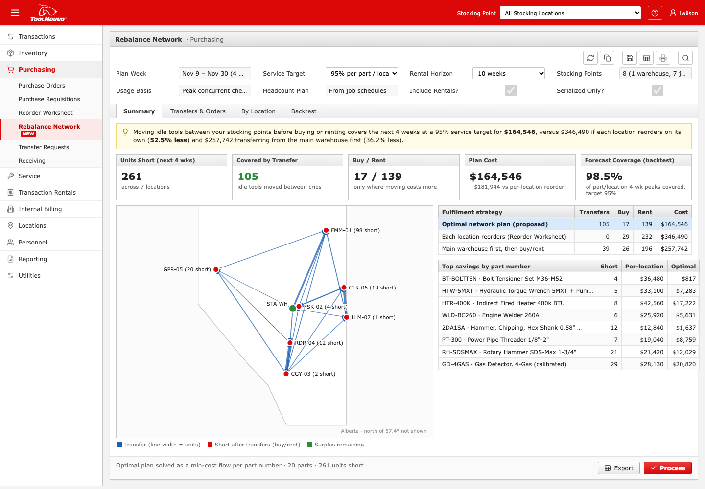

# Rebalance Network for ToolHound 6

**Live demo:** https://mohith26.github.io/toolhound-rebalance-network/ · unofficial concept by Mohith Gajjela, not affiliated with ToolHound or Beacon Software.

ToolHound's Reorder Worksheet suggests what each stocking location should order from its own Min/Max (or EOQ from **Calculate Min/Max**), and a transfer request needs a hand-picked **From Location**. Meanwhile the Calgary job that is winding down has idle hydraulic torque wrenches while the Fort McMurray turnaround is about to rent them. **Rebalance Network** plans the whole network at once: it forecasts each part's peak concurrent checkouts per location for the next 4 weeks from usage and the job headcount plan, pads the forecast with a per-part conformal margin so every location is covered at a stated service level, then solves an exact min-cost flow that decides, unit by unit, whether to transfer from a site with surplus, buy, or rent. The output is ToolHound's own documents: one transfer request per lane, plus a PO and a rental order. On a simulated 8-location Alberta network, covering the next 4 weeks at a 95% target costs **$164,546**, versus **$346,490** when each location reorders on its own (**52.5% less**) and $257,742 when transferring from the main warehouse first (36.2% less). In a rolling backtest the requirements covered 98.5% of actual 4-week peaks (target 95%).



## Why ToolHound

- ToolHound tracks "the transfer of equipment between various job sites and tool room locations" and sells to construction, mining and energy crews ([about](https://www.toolhound.com/toolhound/about)).
- The [Reorder Worksheet](https://toolhound.helpdocs.io/article/1rk3opumph-using-the-reorder-worksheet) creates a Transfer Request only from one chosen From Location; [Calculate Min/Max](https://toolhound.helpdocs.io/article/pavrwbdq6t-about-calculate-min-max) suggests per-location Min/Max with EOQ from past usage. Neither looks across locations or at upcoming headcount.
- The Logic (Oct 2026): under Beacon, ToolHound "is adding new AI functionality ... to manage purchases of new stock and forecast future requirements."

## How it works

All logic is in [`src/rebalance.js`](src/rebalance.js) (no dependencies; same module in browser and Node).

1. **Requirement, not usage.** For serialized tools what matters is the *peak number checked out at once*, not consumption. Point forecast = recent peak-per-worker rate × the job's planned peak headcount over the next 4 weeks.
2. **Calibrated margin.** Nonconformity `s = (y − f)/√(f+1)` from rolling-origin forecasts whose windows ended before the plan week (no leakage). Per part number (Mondrian split conformal), the `⌈(n+1)(1−α)⌉`-th score gives `required = ⌈f + q·√(f+1)⌉`, which covers each part at ≥ 1−α on average if weeks are exchangeable.
3. **Exact plan.** For each part, a min-cost flow network: surplus at each location (on hand − required) → deficit locations at haversine-distance freight cost (handling + $/km × freight class), plus unlimited *Buy* (price + shipping) and *Rent* (weekly rate × rental horizon + delivery) sources. Successive shortest paths gives the provably cheapest integer plan; a source never drops below its own requirement.
4. **Documents.** Process creates one Transfer Request per lane, a Purchase Order and a Rental Order (persisted), and the plan exports to CSV. Views: Summary (map + strategy comparison), Transfers & Orders (filterable grid), By Location, Backtest, and a per-part drill-down. Deep links: `#/purchasing/rebalance/summary|lines|locations|backtest`, `#/purchasing/rebalance/part/HTW-5MXT`, `#/purchasing/transfers`. Keys: `1-4`, `/`, `P`, `E`, `Esc`, `?`.

## Results

`node scripts/generate.mjs` (seed 20261111): 52 weeks of history (to 8 Nov 2026), 20 serialized part numbers, 8 real Alberta locations (St. Albert warehouse + 7 job sites), synthetic headcount plans (Fort McMurray turnaround ramping up, Calgary and Lloydminster winding down).

| Strategy (same 95% requirements) | Transfers | Buy | Rent | Cost |
|---|---|---|---|---|
| **Optimal network plan** | 105 | 17 | 139 | **$164,546** |
| Each location reorders (Reorder Worksheet) | 0 | 29 | 232 | $346,490 |
| Main warehouse first, then buy/rent | 39 | 26 | 196 | $257,742 |

Rolling backtest (weekly cutoffs from week 30 to 48, 3,040 part-location windows): **98.5%** of actual 4-week peaks were at or below the requirement (target 95%; integer rounding makes it conservative).

## Novelty / prior art

- ToolHound's Min/Max, EOQ-based Calculate Min/Max and Reorder Worksheet are per-location; transfer requests are manual.
- Multi-echelon inventory optimization and lateral transshipment are classic operations research (e.g., lateral transshipment models since the 1980s) and exist in big ERP/supply-chain suites (SAP IBP, Kinaxis), not in tool-crib software for contractors. Tool-tracking competitors (e.g., ShareMyToolbox, Align, Tooltribe, ToolWatch) report utilization and locations; I found no public feature that plans transfers vs buys with a calibrated service level.
- Conformal prediction for inventory requirements is recent research; using a per-part split-conformal margin to set service-level stock in a shipping product is the new part.

## Tests

```
node --test tests/*.test.mjs   # 13 tests, < 0.2 s
```
Haversine sanity, conformal order statistic, split-conformal coverage (randomized), min-cost flow = brute force on random transportation problems, optimal ≤ both baselines (randomized), plans cover every deficit without draining sources below their own requirement, transfer vs buy switching, monotone requirement + headcount scaling, no calibration leakage, backtest coverage ≥ 95%, generator determinism, headline reproduction, CSV export. CI: `.github/workflows/test.yml`.

## Limitations (honest)

- **Synthetic usage, prices and headcounts.** Locations are real Alberta towns with approximate coordinates; list prices, rental rates and freight are assumptions. Nothing used ToolHound customer data.
- **Freight is per unit.** Real transfers ship by truckload per lane; a fixed lane cost makes the problem a fixed-charge network flow (MIP). The UI groups by lane, but costs are linear.
- **Peaks are weekly.** Daily peaks, tool condition (calibration due, out for repair), and reservations would tighten the requirement.
- **Conformal guarantee is marginal** over weeks and locations for each part and assumes exchangeability; a sudden new project outside the headcount plan breaks it.
- The ToolHound 6 browser shell is rebuilt from a TH6 training-video frame, the mobile app screenshots and help-center navigation; the Rebalance page itself is invented.

## Run locally

```
python3 -m http.server 8000   # open http://localhost:8000
node scripts/generate.mjs
node --test tests/*.test.mjs
```
